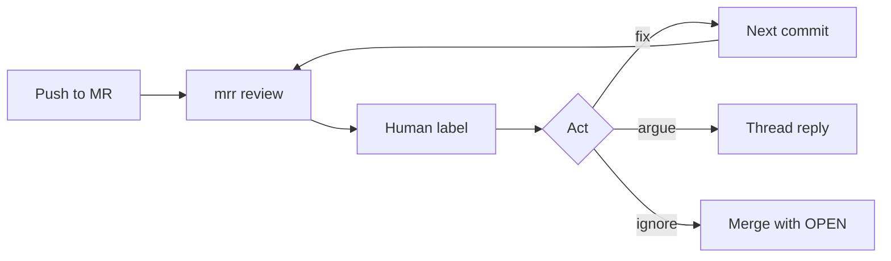

# Experiment — mrr along the way

A study protocol for using mrr as a continuous reviewer while a real project is
implemented. The interesting signal is the loop over time (usefulness, keep-up,
learning, cost), not raw finding count.

Most metrics can be reconstructed **after the fact** from `data/mrr.db`, git,
and GitLab. Labeling as you go is optional and actually changes the behaviour
being studied. The one thing that must not happen is wiping the database.

---

The study question is not "how many findings did the model emit?" It is: **does
a persistent AI reviewer change how a project gets built, and is that change
worth the noise and cost?**

Treat this as an n=1 longitudinal study. Freeze the reviewer setup for a first
phase, then change one variable at a time (skill, model, `agentMaxTurns` /
`read_file`). Log those phase breaks.

## What is already in the database

Every commit is a row in [`reviews`](../src/main/resources/schema.sql) keyed on
`(project, mr_iid, head_sha)`. Findings live across reviews; `OPEN` →
`ADDRESSED` plus `resolved_at` is the built-in time-to-fix, and `OPEN` →
`APPROVED` plus `approved_by` is the built-in disagreement rate — a named human
closed it without a fix. Replies, `inline`,
severity, `files_changed`, `agent_turns`, and `created_at` / `finished_at` are
already there.

Not stored today: human usefulness labels, token/cost, finding category, or a
second opinion for recall.

## The four questions

### 1. Is it useful? (precision, not volume)

These need a human tag per finding: `useful` / `nit` / `wrong` /
`already_knew`. The tag can wait until a reconstruction pass — see
[Post factum](#post-factum). What you cannot recover later is the mental
state (`already_knew`, "I would have caught this anyway").

- **Action rate** — share of findings that become `ADDRESSED` before merge.
  Cheap proxy; biased (a wrong finding may be fixed to silence the thread, or a
  real one ignored).
- **Precision** — `useful / (useful + nit + wrong)`. `already_knew` is
  useful-but-not-new; keep it separate.
- **Severity calibration** — of `BLOCKER`s, how many were actually
  merge-blocking? If blockers are mostly nits, the scale is broken.
- **Location hit rate** — `inline = 1` vs fallback. A correct finding on the
  wrong line is still a miss for the GitLab UX.
- **Reply rate** — findings that get a human note. Arguing is a strong "I
  disagree" signal; silent ignore is weaker.

Trap: `ADDRESSED` is the *model's* later verdict on the same model's earlier
finding. It is not ground truth that the bug existed or that the fix was
because of the review.

### 2. Does it keep up? (the "along the way" part)

- **Review latency** — `finished_at - created_at` vs time to the next push on
  that MR. If the next push routinely lands before `READY`, the reviewer is
  commenting on stale SHAs and the loop is fiction.
- **Commits-to-clean** — pushes on an MR until `mr_status.current_status =
  CLEAN` (or merge with leftovers).
- **Time-to-address** — `findings.resolved_at - findings.created_at` over
  `ADDRESSED` rows only, and **commits-to-address** (how many later `head_sha`s
  before that finding flips). `APPROVED` rows set `resolved_at` too but were
  never fixed, so leaving them in understates the real time-to-fix.
- **Disagreement rate** — `APPROVED` over all closed findings, sliced by
  severity and by `approved_by`. A reviewer who resolves every BLOCKER by hand
  is telling you something about the prompt.
- **WIP vs ready** — draft reviews vs non-draft. Reviewing every draft push
  measures noise on unfinished work; `skipDrafts: true` measures the gate at
  "I think this is done."
- **Overlap** — reviews still `PROCESSING` when the next webhook arrives. High
  overlap means pushes are not waiting; interpret action rate accordingly.

Pick one working rule and stick to it for phase 1: either "push freely, do not
wait" (natural cadence) or "wait for READY before the next push" (serial
loop). Mixing them poisons latency metrics.

### 3. Does anyone learn? (the longitudinal part)

This is the metric family a one-shot review bake-off cannot see.

- **Findings per unit of change** — new findings / `files_changed` (and later
  / LOC added if that is captured). Falling over weeks, with stable precision,
  is the success curve.
- **Recurrence** — same *class* of issue on later MRs after it was already
  addressed once (null-safety, resource close, missing test, etc.). Declining
  recurrence means the skill was internalized; flat means the reviewer is a
  lint that is not absorbed.
- **First review vs later commits on the same MR** — share of new findings on
  commit 2+ vs `still_present` / `addressed` on `prior`. Later commits should
  mostly close threads, not invent work.
- **Escapees** — bugs discovered later (tests, prod, a later reread) that an
  earlier review of that code did not flag. That is recall without planting.
  Log them as `missed` against the SHA that introduced them.
- **Skill churn** — every time a skill or document is edited to shut the
  reviewer up, note it. High churn + falling precision is prompt-fitting, not
  better code.

Optional recall booster: plant 3–5 known defects in one MR (the same method
already used on `test-repo`). Do this once, not on every MR, or the study will
optimize for the plants.

### 4. What does it cost?

- **Wall time per review** — already on the row.
- **Model effort** — `agent_turns`, `read_file` count from `reviews.trace`
  events. Turns that do not change the finding set are wasted hops.
- **Cost per useful finding** — needs token usage (not stored today). Until
  then, use "reviews per useful finding" and "minutes of human time per useful
  finding" (triage + argument + extra commits).
- **Failure tax** — `FAILED` / `error_kind` rate. A reviewer that is down is a
  different experiment.

## Post factum

Yes. Work first, measure later. mrr already keeps the audit trail a
reconstruction pass needs.

Do not wipe `data/mrr.db`. Do not delete the GitLab project. That is the whole
live constraint.

### Reconstructable from the database

Each review row is "this MR at this commit": timestamps, `head_sha`,
`files_changed`, `mr_draft`, `agent_turns`, `error_kind`, the prompt (diff +
the skills and documents as they stood *then*), the response, and the trace
(`read_file` calls, per-turn `elapsedMs`). Findings carry severity, path,
line, `inline`, `OPEN` / `ADDRESSED` / `APPROVED`, `created_at`,
`resolved_at`, `approved_by`. Replies
are the argument transcript.

From that, without any live log:

| Metric | How |
|---|---|
| Review latency | `finished_at - created_at` |
| Overlap / did you wait | next review's `created_at` vs this one's `finished_at` on the same MR |
| Time-to-address, commits-to-address | `resolved_at` on `ADDRESSED` rows, then count later `head_sha`s on that `mr_iid` |
| Action rate | `ADDRESSED` vs `APPROVED` vs still `OPEN` when the MR left `opened` |
| Who overrides what | `approved_by` × `severity` |
| Location hit rate, severity mix, zero-finding reviews | columns as they are |
| Findings per `files_changed` | group by review |
| First vs later commits | new findings on review 1 of an MR vs review 2+ |
| Model effort | `agent_turns` + `role=tool` events in `trace` |
| Failure tax | `state = FAILED` / `error_kind` |
| Skill at review time | the system half of `reviews.prompt` — survives later edits to `agent_skills` |
| Phases | cluster reviews by prompt prefix / model; a skill edit shows up as a new prompt shape |

`mr_status` is live, not a history. Reconstruct CLEAN / NEEDS_WORK from the
finding counts on each review, not from that table. Merge time comes from
GitLab (`merged_at`), not from the snapshot `mr_state` on the last review.

The diff itself is in `reviews.prompt`. If that was truncated, `head_sha` is
still in GitLab.

### Reconstructable from git and GitLab, labeled later

Precision is an evidence pass, not a memory pass. For each finding:

1. Read the thread and any `replies` row.
2. Look at commits on that MR after `created_at` until `resolved_at` or merge.
3. Tag from what happened:
   - commit clearly fixes that finding → `useful` (or you silenced a nit —
     the diff usually tells you which)
   - you argued in the thread → `wrong` or `nit`, as the reply states
   - still `OPEN` at merge → ignored; usually `nit` or `wrong`
   - `already_knew` — skip it; that label dies with the moment

Recurrence: cluster finding titles/bodies across MRs by hand or embedding.
Escapees are *better* late — a bug found in tests or a later MR, blamed to a
SHA, then checked against reviews of that SHA.

### Gone, or only a coarse proxy

- **Token / dollar cost** — not on the trace. Provider dashboards may give a
  daily total, not per review.
- **Minutes you spent triaging** — proxy: `finished_at` to the next commit on
  that MR. Contaminated by lunch, other work, and "I was not waiting."
- **`already_knew` / "I would have caught this"** — mental state.
- **Why a skill was edited** — the *what* is in subsequent prompts; the *why*
  is not.
- **Planted defects** — only if you planted them. You cannot invent a recall
  set after the fact except via escapees.

### Hawthorne

Labeling every finding within 24h makes you a more careful consumer of the
reviewer than you would be naturally. A post-factum pass measures the loop
you actually ran. Prefer that unless a specific question needs the mental
state labels.

## Protocol

No live log is required. After a batch of MRs (~15–20 reviews, or whenever a
phase ends):

1. **Dump** — reviews, findings, replies from `data/mrr.db`; MR merged/closed
   times from GitLab.
2. **Phase** — infer from prompt shape / model; write one line if you remember
   why a skill changed.
3. **Finding labels** — evidence pass as above. Skip `already_knew`.
4. **Escapees** — keep a running list as bugs appear; they accrue after the
   fact by definition.

## Queries (no schema change)

Against `data/mrr.db`, per MR and over calendar time:

- findings opened vs addressed vs still `OPEN` at merge
- median `finished_at - created_at`
- new findings per review vs `files_changed`
- `inline` rate
- severity mix
- reviews that produced zero findings (`CLEAN` on first pass) — a rising share
  is as interesting as a falling one

## What not to optimize for

- Raw finding count (the model can always emit more).
- Time-to-`ADDRESSED` while still learning the tool (early MRs will look
  worse).
- Auto-approve rate (`mrr_approved`) as quality — that is "the model agreed
  with itself."
- Changing the reviewer skill mid-week to chase a nicer graph.

## Later, only if reconstruction gets painful

Instrument mrr with a finding label field, persist token usage on the trace,
and a tiny experiment view. That is a product change; it is not required to
start the study.
