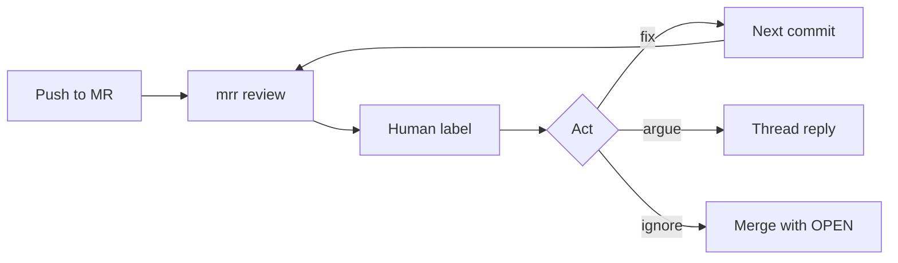

# Experiment — mrr along the way

A study protocol for using mrr as a continuous reviewer while a real project is
implemented. The interesting signal is the loop over time (usefulness, keep-up,
learning, cost), not raw finding count. Most of it can be queried from the
existing SQLite schema; a 30-second human label per finding is what makes the
rest interpretable.

---

The study question is not "how many findings did the model emit?" It is: **does
a persistent AI reviewer change how a project gets built, and is that change
worth the noise and cost?**

Treat this as an n=1 longitudinal study. Freeze the reviewer setup for a first
phase, then change one variable at a time (skill, model, `agentMaxTurns` /
`read_file`). Log those phase breaks.

## What is already in the database

Every commit is a row in [`reviews`](../src/main/resources/schema.sql) keyed on
`(project, mr_iid, head_sha)`. Findings live across reviews; `OPEN` →
`ADDRESSED` plus `resolved_at` is the built-in time-to-fix. Replies, `inline`,
severity, `files_changed`, `agent_turns`, and `created_at` / `finished_at` are
already there.

Not stored today: human usefulness labels, token/cost, finding category, or a
second opinion for recall.

## The four questions

### 1. Is it useful? (precision, not volume)

These need a human label within ~24h, while the reason for acting (or not) is
still in memory. One tag per finding: `useful` / `nit` / `wrong` /
`already_knew`.

- **Action rate** — share of findings that become `ADDRESSED` before merge.
  Cheap proxy; biased (a wrong finding may be fixed to silence the thread, or a
  real one ignored).
- **Precision** — `useful / (useful + nit + wrong)`. `already_knew` is
  useful-but-not-new; keep it separate.
- **Severity calibration** — of `BLOCKER`s, how many were actually
  merge-blocking? If blockers are mostly nits, the scale is broken.
- **Location hit rate** — `inline = 1` vs fallback. A correct finding on the
  wrong line is still a miss for the GitLab UX.
- **Reply rate** — findings that get a human note. Arguing is a strong "I
  disagree" signal; silent ignore is weaker.

Trap: `ADDRESSED` is the *model's* later verdict on the same model's earlier
finding. It is not ground truth that the bug existed or that the fix was
because of the review.

### 2. Does it keep up? (the "along the way" part)

- **Review latency** — `finished_at - created_at` vs time to the next push on
  that MR. If the next push routinely lands before `READY`, the reviewer is
  commenting on stale SHAs and the loop is fiction.
- **Commits-to-clean** — pushes on an MR until `mr_status.current_status =
  CLEAN` (or merge with leftovers).
- **Time-to-address** — `findings.resolved_at - findings.created_at`, and
  **commits-to-address** (how many later `head_sha`s before that finding
  flips).
- **WIP vs ready** — draft reviews vs non-draft. Reviewing every draft push
  measures noise on unfinished work; `skipDrafts: true` measures the gate at
  "I think this is done."
- **Overlap** — reviews still `PROCESSING` when the next webhook arrives. High
  overlap means pushes are not waiting; interpret action rate accordingly.

Pick one working rule and stick to it for phase 1: either "push freely, do not
wait" (natural cadence) or "wait for READY before the next push" (serial
loop). Mixing them poisons latency metrics.

### 3. Does anyone learn? (the longitudinal part)

This is the metric family a one-shot review bake-off cannot see.

- **Findings per unit of change** — new findings / `files_changed` (and later
  / LOC added if that is captured). Falling over weeks, with stable precision,
  is the success curve.
- **Recurrence** — same *class* of issue on later MRs after it was already
  addressed once (null-safety, resource close, missing test, etc.). Declining
  recurrence means the skill was internalized; flat means the reviewer is a
  lint that is not absorbed.
- **First review vs later commits on the same MR** — share of new findings on
  commit 2+ vs `still_present` / `addressed` on `prior`. Later commits should
  mostly close threads, not invent work.
- **Escapees** — bugs discovered later (tests, prod, a later reread) that an
  earlier review of that code did not flag. That is recall without planting.
  Log them as `missed` against the SHA that introduced them.
- **Skill churn** — every time a skill or document is edited to shut the
  reviewer up, note it. High churn + falling precision is prompt-fitting, not
  better code.

Optional recall booster: plant 3–5 known defects in one MR (the same method
already used on `test-repo`). Do this once, not on every MR, or the study will
optimize for the plants.

### 4. What does it cost?

- **Wall time per review** — already on the row.
- **Model effort** — `agent_turns`, `read_file` count from `reviews.trace`
  events. Turns that do not change the finding set are wasted hops.
- **Cost per useful finding** — needs token usage (not stored today). Until
  then, use "reviews per useful finding" and "minutes of human time per useful
  finding" (triage + argument + extra commits).
- **Failure tax** — `FAILED` / `error_kind` rate. A reviewer that is down is a
  different experiment.

## Protocol

Keep a single log (this file's companion, a markdown note, or a GitLab
snippet). Three event types, nothing else:

1. **Phase** — date, model, skill hash, `agentMaxTurns`, `skipDrafts`, and why
   anything changed.
2. **Finding label** — `finding_id`, tag (`useful` / `nit` / `wrong` /
   `already_knew`), five words of why. Optional: reply in the GitLab thread
   with the tag so it sits next to the evidence.
3. **Escapee** — date, SHA that introduced it, one-line bug, "mrr missed /
   mrr had flagged / never reviewed."

Do not add product features until phase 1 has ~15–20 reviews. The existing DB
plus that log is enough to answer the four questions.

## Queries from day one (no schema change)

Against `data/mrr.db`, per MR and over calendar time:

- findings opened vs addressed vs still `OPEN` at merge
- median `finished_at - created_at`
- new findings per review vs `files_changed`
- `inline` rate
- severity mix
- reviews that produced zero findings (`CLEAN` on first pass) — a rising share
  is as interesting as a falling one

## What not to optimize for

- Raw finding count (the model can always emit more).
- Time-to-`ADDRESSED` while still learning the tool (early MRs will look
  worse).
- Auto-approve rate (`mrr_approved`) as quality — that is "the model agreed
  with itself."
- Changing the reviewer skill mid-week to chase a nicer graph.

## Later, only if the log gets painful

Instrument mrr with a finding label field, persist token usage on the trace,
and a tiny experiment view. That is a product change; it is not required to
start the study.
