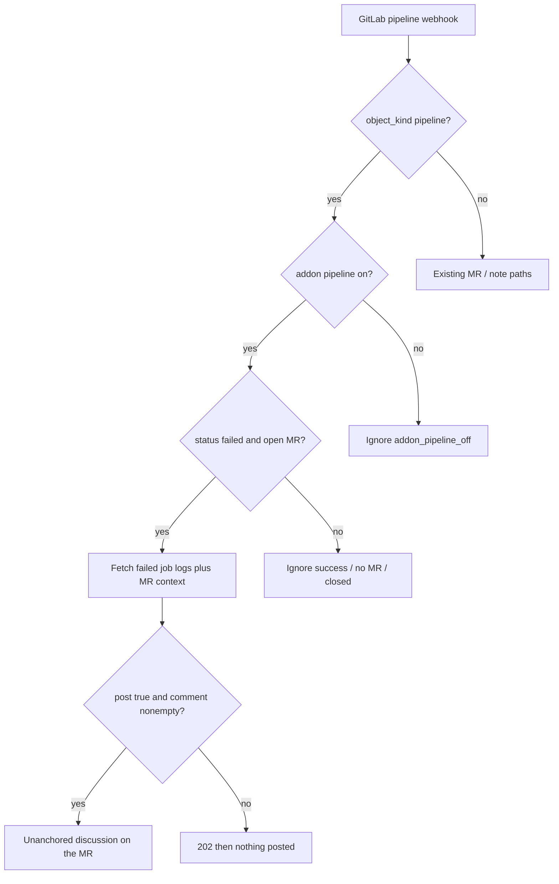

# Pipeline agent — addon

Designed, not built. An **addon** that turns on a **second agent**: same process, same GitLab
PAT, same model key — a different prompt and a different webhook kind. Not a plugin SPI.

GitLab already paints the red X. Restating "job `test` failed" is noise. This agent comments
only when the job log adds something the merge request does not already say.

Default **off**. Existing projects keep today's behaviour. Either the addon or the GitLab
**Pipeline events** tick missing → stays silent.

---

## Why a second agent

The reviewer reacts to merge-request events (open, reopen, new commit) and posts findings.
This agent reacts to pipeline failures on that same MR. Mixing the two in the review loop
would spend a review on every red pipeline, and would key assessments on `head_sha` — a SHA
can fail CI several times after the review of that commit already landed.

| | Reviewer (today) | Pipeline agent (this addon) |
|---|---|---|
| Trigger | MR `open` / `reopen` / new commit | `object_kind: pipeline`, status `failed` |
| Gate | project `enabled` | project `enabled` **and** `addons` contains `pipeline` |
| Off | — | Silent: `200` `addon_pipeline_off`, no model call |
| Output | Findings / threads | One comment, or nothing |
| Storage | `reviews` keyed on `(project, mr_iid, head_sha)` | `pipeline_assessments` keyed on `(project, pipeline_id)` |

---

## Turning it on

Two switches, both required:

1. Project addon `pipeline` enabled (UI checkbox / `addons: ["pipeline"]`).
2. The existing GitLab webhook ticks **Pipeline events** as well as merge-request events.

Same webhook URL and `X-Gitlab-Token`. If GitLab delivers a pipeline event and the addon is
off: `200` with `reason: addon_pipeline_off`, log it, spend nothing.



---

## Addon switch (config)

Named enable-set, same idea as `agentTools`. Empty means none. Handlers stay compiled in.

- Column `projects.addons` (TEXT, comma-separated). `SchemaPatch` adds it on existing DBs,
  like `agent_tools`.
- `Project` grows `List<String> addons` plus `addonEnabled("pipeline")`.
- `ProjectController.Upsert` accepts `addons`; omitted on update keeps current.
- UI: an **Addons** row next to skip-drafts / auto-approve — checkbox `pipeline`. Pill on the
  project list when on.
- Known name: `pipeline`. Unknown names stored, ignored at runtime (same as unknown tool
  names).

---

## Event rules (only when the addon is on)

| Delivery | Action |
|---|---|
| `pipeline` / `failed`, payload has an open MR | Assess |
| `pipeline` / `success`, `running`, `canceled`, `skipped` | Ignore |
| `pipeline` with no `merge_request` | Ignore (nowhere to talk — same reason tag events are out of scope) |
| `build` (per-job) | Ignore — wait for the pipeline to finish |

Dedupe on `(project_id, pipeline_id)`. A redelivered hook is free. A retry is a new pipeline
id, so a new assessment — the log may differ.

Parse in `WebhookPayload`: `object_kind`, `object_attributes.status`, `object_attributes.id`,
`object_attributes.sha`, `merge_request.iid` / `state`, failed `builds[]` (id, name, stage,
`allow_failure`, `failure_reason`). Skip `allow_failure` jobs.

The webhook has job *names* and `failure_reason`, not the log. Assessment without the trace
would only restate GitLab's red X, so the agent fetches `GET /jobs/{id}/trace`.

---

## GitLab permissions

**Write side is unchanged.** Posting still uses `Merge request: Update` / `Create`
(`POST /discussions`). No new write scope.

**Read side needs job logs**, which today's review PAT does not cover.

| Token | Extra for this addon |
|---|---|
| Classic PAT, scope `api` | No. Job traces are under `api`. Token owner still needs Reporter+ on the project (Guest cannot see CI logs on a private repo). |
| Fine-grained PAT | **Yes — Job: Read** (`read_job`). That is `GET /projects/:id/jobs/:job_id/trace`. `read_code` + MR read/update/create 403 this endpoint. |

A 403/404 on the trace is fail-closed: record `errorKind=GITLAB`, UI banner, **do not** post
"job `test` failed" from names alone.

Addon-only row in the README GitLab-setup table, same pattern as Approve for `autoApprove`.
The live test PAT must be reissued (or given Job: Read) before live verification.

---

## Assessment loop

`PipelineAssessor`, next to `Replier`. Webhook returns `202` immediately; the model call runs
on a background thread. Nothing that calls an LLM may block a GitLab delivery.

New table `pipeline_assessments` — not `reviews`. A review is one commit; one SHA can fail CI
several times after that review landed.

- `project_id`, `mr_iid`, `pipeline_id` (unique), `sha`
- `posted` (0/1), `reason`, `prompt`, `response`, `discussion_id`
- `error` / `error_kind`, `created_at`

`GitLabClient` gains job-trace fetch: last N chars of each failed job
(`mrr.review.max-job-log-chars`, default 12_000), cap at 3 failed jobs.

Context sent to the model:

- Failed job names, stages, `failure_reason`, truncated traces
- Open findings on that MR
- Previous pipeline comments on that MR
- Latest review summary, if any

### The "necessary" gate

Same asymmetry as thread resolution: **leaving it unsaid costs nothing; a useless comment
costs a lot.**

Structured verdict:

```json
{ "post": false, "reason": "already_covered" }
```

or

```json
{ "post": true, "comment": "...", "reason": "new" }
```

Anything other than an explicit `post: true` with a non-empty `comment` stays off the MR.
Unparseable, refused, quota, GitLab down: fail closed, nothing posted.

**Stay silent when** the failure is already an open finding thread, the log is empty or
canceled-because-pipeline-failed, or the assessment would only repeat GitLab's own UI.

**Comment when** the log shows a real defect the review missed, or an actionable
CI / config / test-update the author would not get from the red X plus existing threads.

Post as one unanchored discussion (logs are not a diff line).

---

## Out of scope for v1

- Congratulating on green
- Auto-resolving the pipeline thread when a later pipeline succeeds
- Answering replies on that thread
- Per-job (`build`) events
- Branch / tag pipelines with no merge request

---

## Implementation notes (when built)

- `SchemaPatch` + `schema.sql` for `projects.addons` and `pipeline_assessments`
- Tests: payload parsing, addon-off short-circuit, silence unless `post: true`, unique
  `(project, pipeline_id)`, 403 on trace fails closed
- README event table + GitLab-setup **Job: Read** row; CHANGELOG unreleased entry
- `docs/PLAN.md` event-matrix row, marked built only after a live GitLab pipeline failure
