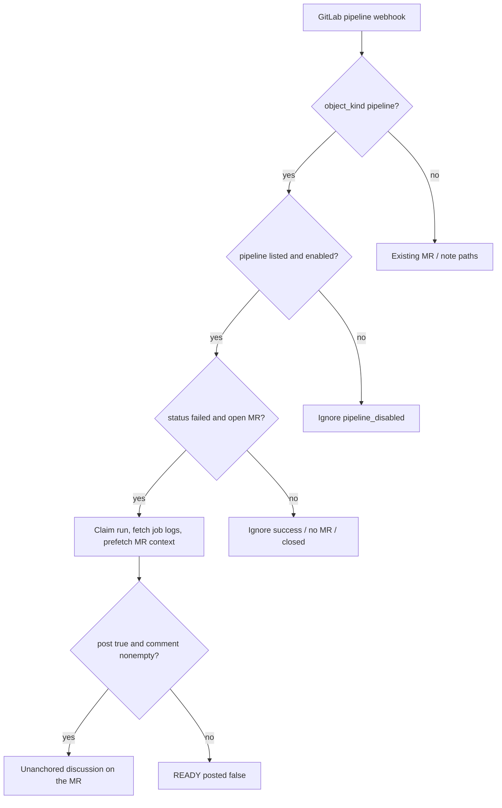

# Pipeline agent — addon

Designed, not built. Pipeline is the second **agent addon**. Addons are a **named set you add
to a project**, same idea as skills: add to the list (enabled by default), disable without
removing, disable never deletes what the agent already wrote.

Not a plugin SPI. The catalog is compiled in. Not a growing pile of booleans on `Project`
(`librarianEnabled`, `pipelineEnabled`, …) — that does not scale, and it has nowhere to hang
"what else this agent needs from GitLab."

GitLab already paints the red X. Restating "job `test` failed" is noise. This agent comments
only when the job log adds something the merge request does not already say.

---

## Agent addons (the list)

Compiled-in catalog plus per-project rows. Skills, not `agentTools`: `agentTools` is a
comma-separated bag with no page and no requirements. An agent addon has a name, a toggle,
and a **requirements page**.

| | On the project | Enabled | Off / disable |
|---|---|---|---|
| How | `POST` the catalog name onto the project | default **true** on add | `enabled: false`; row stays |
| Librarian | `addons` contains `librarian` | Initialize / Refresh works | 409 on refresh; `project/` files stay |
| Pipeline | `addons` contains `pipeline` | failed-MR pipelines assessed | `200 pipeline_disabled`; assessment rows stay |

Gate at runtime: **on the list and `enabled`**. On the list but disabled is silent, same as a
disabled skill.

Migrate the shipped librarian boolean: `librarian_enabled = 1` → insert
`(name=librarian, enabled=1)`. Keep `Project.librarianEnabled` as a **derived alias**
(`librarian` is listed and enabled) so today's UI and API keep working until they read the
list.

```
GET  /api/addons                          # catalog (id, title, description, requires[])
GET  /api/projects/{id}/addons            # catalog merged with installed/enabled
POST /api/projects/{id}/addons            # { "name": "pipeline" } → enabled true
GET  /api/projects/{id}/addons/{name}     # detail + live requirement checks
PUT  /api/projects/{id}/addons/{name}     # { "enabled": false } — row stays
```

Unknown names 400. Delete is not required in v1 (disable is enough). Table `project_addons`
(`project_id`, `name`, `enabled`, `created_at`), unique `(project_id, name)`.

---

## Requirements page

Each catalog entry declares what GitLab must grant **beyond the review loop**. The project
addon page (`/projects/{id}/addons/{name}`) is where that is shown — not a footnote in
README. Enabling without the extras fail-closes at runtime; the page should say so before
the first 403.

Catalog shape:

```
name: pipeline
title: Pipeline agent
requires:
  - kind: webhook_event
    name: Pipeline events
    why: Same webhook URL; tick this in GitLab Settings → Webhooks.
  - kind: gitlab_permission
    name: Job: Read
    why: GET /projects/:id/jobs/:job_id/trace
    probe: GET /projects/:id/jobs?per_page=1
```

Librarian declares an empty `requires` — tree and file read are already the review token.

On the page:

- Short description, enabled toggle (add-to-list if not installed; adding enables).
- **Needed** list: each requirement as ok / missing / unknown.
- `gitlab_permission` is probed live when the page loads (Job: Read → `GET …/jobs?per_page=1`;
  200 = ok, 403 = missing, anything else = unknown). Do not treat 404-no-jobs as missing.
- `webhook_event` cannot be probed (mrr has no webhook-API scope by design). Shown as an
  instruction, not a green tick. If the addon is on and GitLab never delivers that kind, the
  webhook log (`pipeline_disabled` is the other case) is how you see it.

Classic PAT `api` already includes Job: Read. Fine-grained review tokens do not. Write is
unchanged (`POST /discussions`). A 403/404 on the trace at run time is fail-closed: run
`FAILED`, `errorKind=GITLAB`, UI banner, **do not** post from job names alone.

---

## Pipeline agent (when listed and enabled)

Two switches, both required: addon enabled on the project, and **Pipeline events** ticked on
the existing webhook. Either missing → silent.

| | Reviewer | Librarian addon | Pipeline addon |
|---|---|---|---|
| Trigger | MR webhook | Initialize / Refresh | pipeline webhook, `failed` |
| Skill | project skill set | `skills/librarian.md` | `skills/pipeline.md` |
| Turns | `agentMaxTurns` | `librarianMaxTurns` (6) | `pipelineMaxTurns` (1) |
| Tools | opt-in `agentTools` | tree / file / memory / librarian write | none in v1 — prefetch logs |
| Run table | `reviews` | `memory_runs` | `pipeline_assessments` |
| Trail | yes | yes | yes |

Shared: same process, PAT, model key, `Agent` loop, fail-closed kinds. Reviews never wait on
either addon.



### Event rules

| Delivery | Action |
|---|---|
| `pipeline` / `failed`, open MR | Assess |
| success / running / canceled / skipped | Ignore |
| no `merge_request` | Ignore |
| `build` (per-job) | Ignore |

Dedupe `(project_id, pipeline_id)`. Retry = new pipeline id = new assessment.

### Loop

`PipelineAgent` next to `Librarian`. Classpath skill, worker pool size 1, `202` + `Location`
to the run. Prefetch: truncated traces (last 12_000 chars, 3 jobs), open findings, prior
assessments, latest summary.

`pipeline_assessments` = `memory_runs` columns plus `mr_iid`, `pipeline_id`, `sha`, `posted`,
`reason`, `discussion_id`, `error_kind`. READY + `posted=0` is successful silence.

```json
{ "post": false, "reason": "already_covered" }
```

or `{ "post": true, "comment": "...", "reason": "new" }`. Anything else stays off the MR.

REST: `GET /api/projects/{id}/pipeline-assessments[/{runId}]`; MR cycle lists them. UI Trail
on the run.

---

## Out of scope for v1

- Congratulating on green, auto-resolve, replies on the pipeline thread
- Per-job events, branch pipelines with no MR
- Tools on this agent
- Deleting an addon row (disable is enough)
- Probing whether GitLab actually ticked Pipeline events

---

## Implementation notes (when built)

- Catalog class + `project_addons` + librarian migration + derived `librarianEnabled`
- Addons UI: list on the project, detail page with live Job: Read probe
- `PipelineAgent`, `skills/pipeline.md`, assessments table
- Tests: add-enables, disable-stays, unknown name 400, probe 403, silence unless `post: true`
- README GitLab-setup: point at the addon page rather than a static Job: Read footnote
